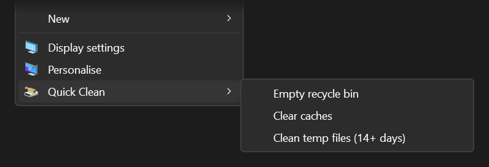

<h1 align="center">tidy-menu</h1>

<p align="center">
  A shorter right-click menu for Windows, plus a few entries worth adding.<br/>
  It installs for your user only and needs no admin rights.
</p>

<p align="center">
  <a href="LICENSE"></a>
  <a href="https://github.com/Ramonvdo/tidy-menu/actions/workflows/ci.yml"></a>
</p>

<p align="center">
  
</p>

## What you get

The installer asks about each of the six modules, so you only get the ones you want.

| Module | What it does | Default |
|---|---|---|
| Full menu | Windows 11 shows the whole right-click menu at once, without the "Show more options" step. | Yes |
| Hide Windows extras | Removes Restore previous versions, Always available offline, Work Folders, Scan with Microsoft Defender, and the encryption entries. | Yes |
| Hide app extras | Removes the folder entries that Git for Windows, VLC and Visual Studio add. Offered only if one of them is installed. | No |
| Open in Terminal | Opens Windows Terminal in the folder you right-clicked, or in the folder you're looking at. Offered only if Windows Terminal doesn't already add its own, so you don't get two. | Yes |
| Open Claude Code here | Opens Windows Terminal in that folder and starts [Claude Code](https://claude.com/claude-code). Offered only if `claude` is on your PATH. | Yes |
| Quick Clean | A desktop submenu that empties the Recycle Bin, clears caches, or deletes temp files older than 14 days. | Yes |

## Install

1. Download **Source code (zip)** from the [latest release](https://github.com/Ramonvdo/tidy-menu/releases/latest) and extract it.
2. Double-click `install.cmd` in the extracted folder. If Windows warns that the file came from the internet, choose **Run** (or **More info**, then **Run anyway**).
3. Answer yes or no for each module. The window stays open at the end so you can read what was installed.

`install.cmd` starts `install.ps1` with PowerShell's execution policy bypassed for that one run, so you don't have to change any settings.

There's no paste-into-PowerShell installer, on purpose. Microsoft Defender can flag a command that downloads a script and runs it straight away, and report it as a trojan.

If you prefer a terminal, clone the repo and run the installer. In a folder extracted from the zip, only the last line is needed:

```powershell
git clone https://github.com/Ramonvdo/tidy-menu.git
cd tidy-menu
powershell -ExecutionPolicy Bypass -File .\install.ps1
```

To install without the questions, name the modules you want:

```powershell
.\install.ps1 -Modules ClassicMenu, HideWindowsEntries, OpenTerminal, QuickClean -RestartExplorer
```

The module names are `ClassicMenu`, `HideWindowsEntries`, `HideAppEntries`, `OpenTerminal`, `OpenClaude` and `QuickClean`.

The full menu and the hidden Windows entries only appear after Explorer restarts. The installer offers to restart it for you, which closes any open File Explorer windows. Running the installer again replaces the previous install, so you can change your picks whenever you like.

## Quick Clean

Right-click the desktop and open **Quick Clean**.

| Entry | What it deletes |
|---|---|
| Empty recycle bin | Everything in the Recycle Bin. It asks first and shows how many items and how much space. |
| Clear caches | The cache folders of Chrome, Edge, Brave, Firefox and Zen (a browser that's running is skipped). It also runs `npm cache clean --force`, `uv cache clean`, `pip cache purge` and `go clean -cache` for whichever of those you have, and removes the downloaded crate archives in `~\.cargo\registry\cache`. |
| Clean temp files (14+ days) | Files in `%TEMP%` and `C:\Windows\Temp` that haven't changed in 14 days. Files that are in use, or that your account can't delete, are left alone. |

When it finishes, a notification tells you how much space came back. Quick Clean never touches cookies, history, saved passwords or logins.

If you write Rust, the installer also asks for your project folders. If you give some, Clear caches also deletes the `target` build folders of the Rust and Tauri projects inside them, and cargo rebuilds them on the next build. A folder counts only if it's called `target`, sits next to a `Cargo.toml`, and contains `.rustc_info.json`.

To see what would go without deleting anything:

```powershell
powershell -ExecutionPolicy Bypass -File "$env:LOCALAPPDATA\tidy-menu\quick-clean.ps1" -Mode Caches -DryRun
```

## Uninstall

Go to **Settings > Apps > Installed apps**, find **tidy-menu** and choose **Uninstall**. Or run:

```powershell
powershell -ExecutionPolicy Bypass -File "$env:LOCALAPPDATA\tidy-menu\uninstall.ps1"
```

The installer writes down every registry change it makes, and the uninstaller plays that list back in reverse. It removes what it added, puts back the old value of anything it changed, and leaves other software's entries alone.

## How it works

Everything is written under `HKEY_CURRENT_USER`, so other accounts on the PC don't see it and no admin prompt appears.

| Module | Registry change |
|---|---|
| Full menu | An empty `InprocServer32` key for CLSID `{86ca1aa0-34aa-4e8b-a509-50c905bae2a2}`, the widely used switch back to the classic menu. |
| Hide Windows extras | The CLSIDs of those shell extensions go under `Shell Extensions\Blocked`. Blocking "Restore previous versions" also hides the Previous Versions tab in a file's Properties. |
| Hide app extras | A `LegacyDisable` value on each app's menu entry, for your user only. The apps themselves stay as they are. |
| Open in Terminal, Open Claude Code here | Entries under `Directory\shell` and `Directory\Background\shell` that run `wt.exe -d "%V\."`. The `\.` stops a drive root like `C:\` from breaking the quoting. |
| Quick Clean | A submenu under `DesktopBackground\Shell` that runs `quick-clean.ps1` through `conhost.exe --headless`, so no console window flashes. |

The scripts the menu runs live in `%LOCALAPPDATA%\tidy-menu`, next to the uninstaller, the Terminal icon and `state.json` (the list of changes).

The repo contains no app logos. The installer copies the Terminal icon from your installed Windows Terminal, and the Claude entry uses the icon inside your `claude.exe`.

## Requirements

- Windows 11. Windows 10 should also work: the full-menu module is skipped there because Windows 10 already has it, and everything else uses the same registry keys. Only Windows 11 has been tested.
- Windows PowerShell 5.1, which ships with Windows.
- Windows Terminal, for the Terminal and Claude Code entries.
- Claude Code, for its entry.

## Also from this author

[Folder Colors](https://github.com/Ramonvdo/folder-colors) lets you colour-code folders from the same right-click menu.

## License

MIT. [SECURITY.md](SECURITY.md) lists exactly what tidy-menu changes and how to report a problem.
